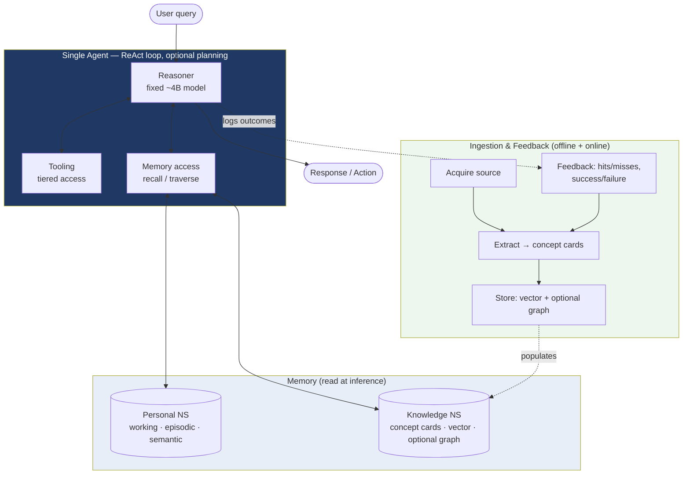
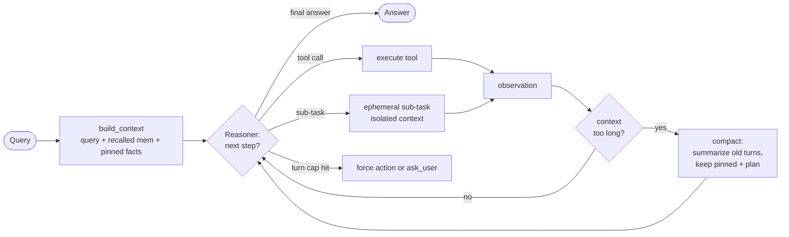
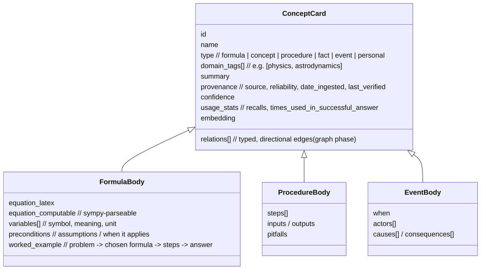
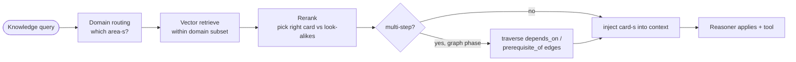
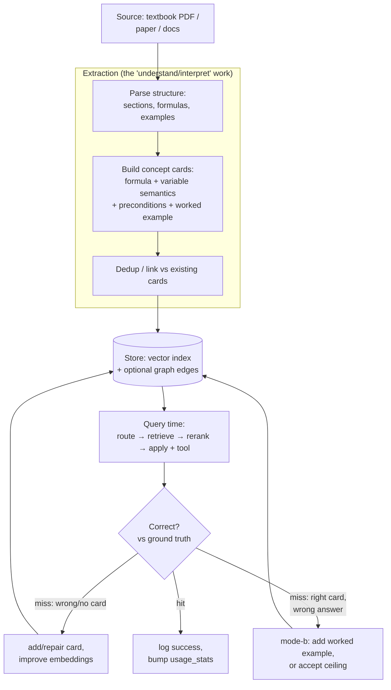
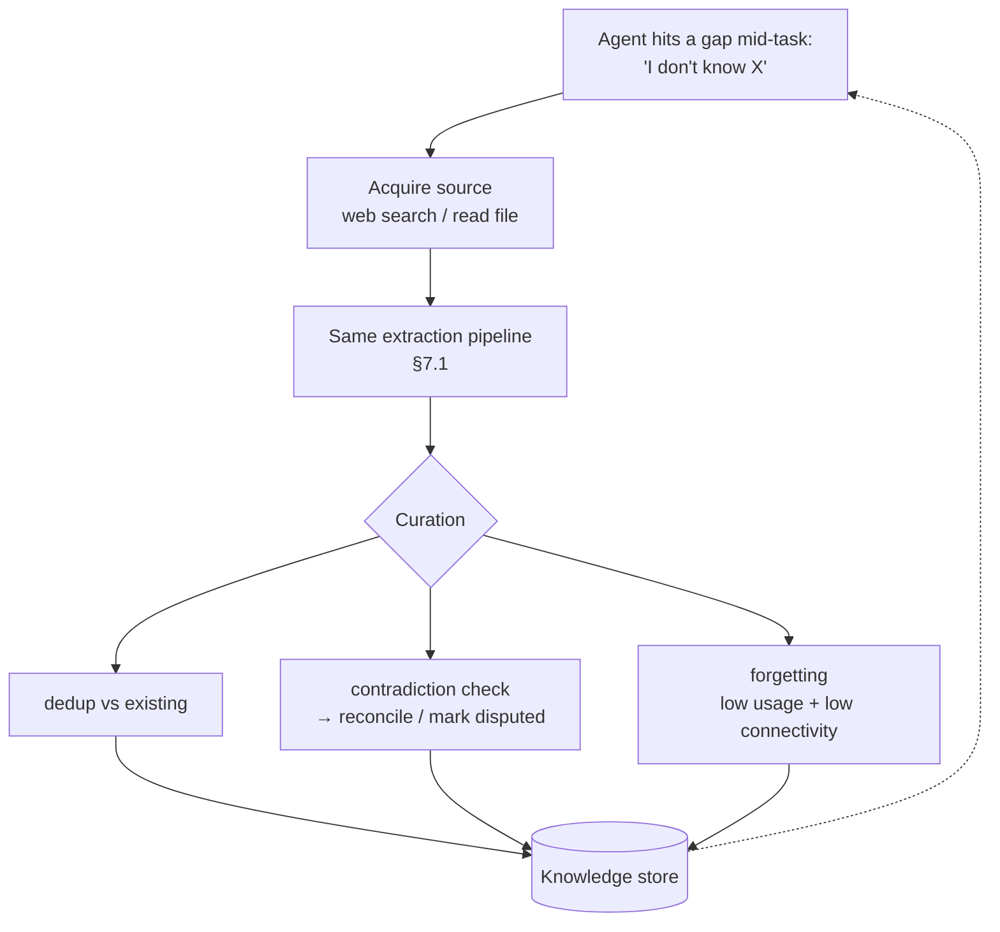
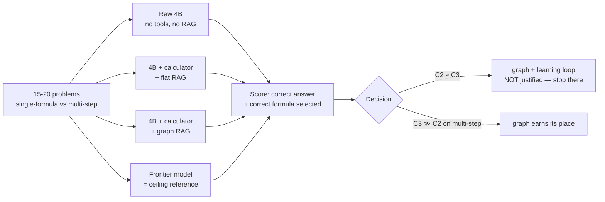
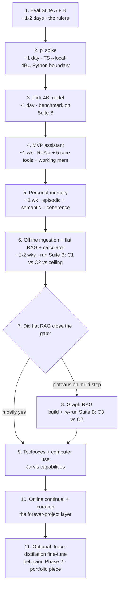

# Doba — Design Document

> Local-first personal assistant built on a small model and a strong harness. A private Jarvis for daily life, plus a **knowledge layer** that lets it close knowledge gaps by retrieving curated, structured knowledge and using tools — without ever retraining the model.

**Status:** design / pre-build · **Owner:** Felipe · **Last revised:** this version supersedes the original draft.

---

## 0. What changed from the first draft (and why)

The original draft made one big promise — *"the agent gets broadly smarter over time via cross-domain transfer"* — and built a large machine (typed knowledge graph, mastery scoring, forgetting, self-directed study) to justify it. After scrutiny, that promise is **mechanically overstated** for a retrieval-based system, and most of the machine isn't needed to deliver the actual wins. This revision re-scopes the project around what the architecture can really do:

1. **The thesis is narrowed and made testable.** Doba is not "an agent that becomes broadly more intelligent." It is *"a small model whose reasoning is unblocked by tools (for verification/computation) and retrieval (for missing knowledge), at near-zero token cost."* That is a real, defensible, measurable claim.
2. **Retrieval ≠ understanding.** Pulling a fact/formula into context fixes *missing knowledge*. It does **not** fix *reasoning depth* (selecting, mapping, composing). We separate these two failure modes and design for the first, while being honest about the residual ceiling of the second.
3. **The unit of knowledge is a structured *concept card*, not a text chunk.** This is the single most important design decision and the thing that makes retrieval *usable* by a small model.
4. **Build order is evidence-gated.** Structured-RAG + rerank + tools first, measured against a raw baseline and a large-model ceiling. The graph, the online learning loop, and forgetting are added *only when an experiment shows the simpler thing plateaus.*
5. **Fine-tuning is the wrong tool for knowledge** and the right tool (later, optionally) for *behavior*. Documented explicitly to avoid the overfit trap.
6. **The grand "learning loop" is split** into an offline ingestion pipeline (build this) and an online continual layer (the forever-project extension), which are the *same pipeline* with a different trigger plus curation.

The north-star Jarvis is still the point — it's an explicit forever-project. But the parts that *prove anything* are now cleanly separated from the parts that are open-ended tinkering.

---

## 1. Vision

**Doba is a private, local AI that does two things:**

1. **Daily-life assistant** — reminders, lookups, computer/terminal/browser use, explanations on request.
2. **Knowledge-augmented reasoner** — when the model lacks a fact, formula, or procedure, Doba retrieves it from a curated, structured knowledge store and applies it with tools (calculator, code, search), closing the gap *at inference time* rather than in the weights.

It runs on a consumer GPU with a small (~4B) model and compensates for the model's limited base knowledge by being exceptionally good at **context engineering, tool use, and structured knowledge ingestion**.

### Core thesis (re-scoped)

> A small local model has *decent reasoning* but *unreliable knowledge and verification*. If the harness (a) gives it ground-truth tools to verify/compute and (b) retrieves the specific knowledge it lacks as clean, applicable units, then a ~4B model closes much of the gap to a frontier model **for lookup-and-apply tasks**, at effectively zero token cost.

This is **not** a claim that the agent becomes broadly more intelligent. It becomes **better-read and better-equipped**, which is a different and more achievable thing.

### The two failure modes (the conceptual core)

Every "the small model failed" event is one of two kinds. The whole design hinges on telling them apart:

| | **(a) Knowledge / verification failure** | **(b) Reasoning-depth failure** |
|---|---|---|
| What's missing | A fact, formula, constant, or the ability to *confirm* a result | The ability to select the right approach, map the problem onto it, and compose multiple steps |
| Example | Doesn't know vis-viva; or knows it but spirals re-checking arithmetic | Has all formulas in context but can't figure out which to use or how to chain them |
| Fixed by | **Tools (calculator/code/search) + retrieval** | **Nothing in the harness** — this is the model's capability ceiling |
| Doba's stance | Design for this. This is the win. | Acknowledge it. Raise the floor with worked-example cards, but don't pretend tools erase it. |

**Observed evidence (n=1, a hypothesis not a result):** given an astrodynamics problem with no tools, the 4B reached the correct answer several times *in its trace* but kept second-guessing because it couldn't verify the number — a textbook (a) failure. A calculator tool would let it verify once and commit. Note: the long "thinking" here is the **bug, not a feature** — it's the spiral of an ungrounded model. Tools should make traces *shorter* (verify → commit), not longer. We do **not** optimize to "exploit long thinking"; we optimize to *kill the spiral with ground truth.*

### What "learning" means here (re-scoped)

Original framing: the model gets smarter. Honest framing: **the knowledge store gets better, and the model reads from it.** "Learning" in Doba = a pipeline that turns sources into structured, retrievable, applicable knowledge, plus a feedback loop that improves the *store* where it fails. The model's weights never change.

### Goals
- Local and private (no data leaves the machine by default).
- Reliable for daily-life tasks: scheduling, reminders, lookup, computer/terminal/browser ops.
- **Close knowledge gaps via retrieval + tools**, measurably, without retraining.
- Coherent over long timeframes — remembers the user's world and what it has ingested.
- **Cost:** near-zero marginal inference cost (local 4B at ~75 tok/s on the target GPU).

### Non-goals
- Frontier-grade creative/novel work (complex original code, research, design).
- Tutoring as a feature (no curricula, no spaced repetition, no user-mastery tracking).
- Multi-user / multi-tenant. This is *my* assistant.
- Uniform competence across *all* knowledge. Doba is strong on fact/formula/procedure-shaped domains and progressively weaker on interpretive/judgment-shaped ones. This is by design, not a defect to fix.
- Beating a frontier model on reasoning-depth (mode-b) tasks.

### Why a small model can work here
Small models are weak at long reasoning chains and rare-knowledge recall, but often good enough at:
- Following a clear instruction with the right context already loaded.
- Choosing among 3–5 well-defined options.
- Summarizing/transforming text already in context.
- **Extracting structured information from unstructured text** — the engine of the ingestion pipeline.

The harness's job is to **shape every model call into the kind of call small models are good at**: short, focused, with the relevant knowledge and tools pre-selected.

### The cost reframe (why model size is the right tradeoff)
No model — small *or* frontier — reliably holds "all knowledge" in its weights. Breadth is a **lookup problem for everyone**. What a frontier model buys you is *deeper reasoning over what's in context* (mode-b), not more reliable breadth. So choosing a 4B costs you **reasoning ceiling, not knowledge breadth** — because breadth is retrieval, which is model-size-independent. That is exactly the tradeoff Doba is built to exploit.

---

## 2. Architecture Overview

One agent. Three subsystems — **Reasoner** (the fixed small model), **Tooling** (tiered), **Memory** (personal + knowledge). The **Ingestion & Feedback pipeline** runs alongside, populating and improving the knowledge store. The model never changes; everything that "learns" lives in the store.

**Reading guide:** the left/top loop (agent + tools + memory read) is the *runtime*. The bottom box (ingestion + feedback) is the *learning system*. They touch only through the knowledge store and the outcome log. This decoupling is deliberate: the assistant works even if the learning system is empty, and the learning system improves the store without touching the running agent.

---

## 3. Pillar 1: Harness

### Decision: ReAct loop with optional explicit planning, built on `pi`

The agent runs a ReAct loop (Thought → Action → Observation → repeat) by default. When it judges a task needs planning, it calls a `make_plan` *tool* that emits a checklist; the loop then executes against it.

### Why
- **ReAct fits small models** — each turn is short ("what next?"), not "solve the whole thing."
- **Pure Plan-and-Execute is brittle** — small models plan upfront with poor info and can't replan well.
- **Hybrid wins** — planning becomes a capability invoked on judgment, like a human reaching for a checklist only when needed.

### Framework choice: `pi` (`@mariozechner/pi-agent-core` + `pi-ai`)

`pi` (earendil-works/pi, formerly `pi-mono`) is an actively maintained, popular (~46k★, releases through 2026) TypeScript agent toolkit. Relevant pieces:

- **`pi-ai`** — unified multi-provider LLM API with streaming, tool calling (TypeBox schemas), thinking/reasoning support, token/cost tracking, and **support for any OpenAI-compatible endpoint** → works directly with a **local Ollama / vLLM** server hosting the 4B.
- **`pi-agent-core`** — the agent loop: tool execution, validation, event streaming, state management, message queuing, attachments, and a **`shouldStopAfterTurn` callback** (directly useful for "stop once verified — don't spiral").
- Design philosophy is **minimal context engineering** — exactly what the small-model thesis needs.

**The one real friction: `pi` is TypeScript; the original stack assumptions (FastAPI, sentence-transformers, etc.) are Python.** Two honest options:

| Option | Pros | Cons |
|---|---|---|
| **A. Go TS for the agent/harness**, keep a thin Python service only for ML bits that lack good TS equivalents (some embedding models) | Use `pi` as-is; one language for the whole agent; strong ecosystem fit | Embeddings/ML tooling weaker in TS; may need a Python sidecar anyway |
| **B. Stay Python**, use `pi` only as a *reference architecture* (reimplement the loop) or via a subprocess/HTTP boundary | Keep Python ML ecosystem (sentence-transformers, etc.) | Lose the main value of `pi` (you're rebuilding the loop); integration overhead |

**Lean: Option A.** `pi` *is* the harness, run the 4B via an OpenAI-compatible local endpoint, and put embeddings/graph behind a small local service the agent calls as a tool. **Action item:** 1-day spike — toy ReAct loop in `pi` with 3 tools against the local 4B, plus a `recall` tool that hits a stub Python embedding service. This validates the cross-language boundary early.

### Alternatives considered
- **Pure Plan-and-Execute** — rejected (brittleness).
- **Reflexion-style self-critique** — adds latency; small models self-critique shallowly. Defer.
- **Tree-of-Thoughts / search** — too expensive for always-on local. Defer.
- **LangGraph / smolagents / custom** — viable, but `pi`'s minimalism, OpenAI-compatible local support, and the `shouldStopAfterTurn` hook fit the thesis better. Worth a side-by-side only if the spike reveals a blocker.

### Case studies to mine
Claude Code, Codex, OpenClaw (which is built on `pi`), Hermes Agent. Extract: long-context compaction, tool-error/retry handling, "done vs need-more-info" signaling.

---

## 4. Pillar 2: Agent Architecture

### Decision: Single agent with ephemeral sub-tasks

One persistent agent owns the conversation, memory, and high-level loop. For narrow operations ("search web for X and summarize"), it spawns an **ephemeral sub-task** with isolated context that returns a single condensed observation; the main agent never sees the sub-task's intermediate steps.

### Why
- **Single agent keeps context coherent** — one source of truth for "what's happening now."
- **Multi-agent coordination is the hard part**, and small models are *especially* bad at it. Avoid until forced.
- **Sub-tasks capture most of the multi-agent benefit** (context isolation, focused tools) without coordination overhead.

### How a query flows
1. Receive query.
2. **Triage:** is this knowledge-shaped (needs recall/ingestion) or action-shaped (reminder, command)?
3. **Recall** relevant cards / personal facts (the agent decides *whether* and *from which namespace*).
4. **Sufficiency check** — can I answer from context + reasoning now?
5. If not: retrieve more, call a tool, ingest a source, or ask a clarifying question.
6. Execute, observe, loop to 4.
7. Answer, then **log the outcome** to the feedback system (and write personal lessons-learned if the task was non-trivial).

This is ReAct with two opinionated additions: an explicit recall step early and an explicit outcome-log step at the end.

### Open sub-questions
- Trigger for `make_plan`: self-judgment via prompt, fallback heuristic (multi-step verbs / token count). **Lean: self-judgment + fallback.**
- Sub-task failure: retry or surface? **Lean: surface; let the main agent decide.**

---

## 5. Pillar 3: Memory

### Decision: two namespaces; concept-card knowledge units; mostly tool-accessed

**Personal namespace** — the user's life and the agent's history with the user. **Knowledge namespace** — the world model, as structured concept cards.

| Layer | Namespace | Contents | Storage | Access |
|---|---|---|---|---|
| **Working** | shared | Current convo, scratchpad, active plan | In-context | Always present |
| **Episodic** | personal | Past conversations/events | Vector, timestamped | Tool-recall |
| **Personal semantic** | personal | Stable user facts, entities, preferences, lessons-learned | Graph + vector | Tool-recall + thin auto-inject |
| **Knowledge** | knowledge | Concept cards (see below) | Vector first; graph later | Tool-recall + traverse |

### The concept card — the most important design decision

The unit of knowledge is **not a text chunk**. Naive chunk-RAG over a textbook retrieves a paragraph that *mentions* a formula but doesn't hand the model something it can *apply*. A concept card is a typed, structured, self-contained, applicable unit.

A card is **polymorphic by type** — different knowledge has different shapes. A formula card is not shaped like a historical-event card or a procedure card. Shared envelope + type-specific body:

**Why the worked example matters:** including a solved example inside the card hands the model the *application pattern*, not just the formula. This directly attacks mode-(b): the model sees variable-mapping and step composition demonstrated, which raises the floor on "knows the formula but can't apply it." It doesn't erase the ceiling, but it lifts the floor cheaply.

### Auto-inject vs explicit recall
- **Auto-inject only a tiny "pinned facts" slice** — user identity, hard preferences, current high-priority projects.
- **Everything else is tool-accessed**: `recall_personal(query)`, `recall_knowledge(query)`, `traverse(node, relation)` (graph phase). Keeps context lean — critical for small models.
- First step of a knowledge query: "should I recall, and from where?" — the agent decides.

### Why not auto-inject everything (RAG-style firehose)
Bloats context (worse for small models), pollutes reasoning with semi-relevant noise, and makes every answer hostage to retrieval quality even when retrieval wasn't needed.

### Retrieval at scale: domain routing (why two namespaces earn their keep)
For one textbook, routing is unnecessary (one shelf). For *all knowledge*, the haystack is huge and full of confusable neighbors ("entropy": physics vs information theory; "stress": engineering vs psychology). So the general system needs a **librarian step**: classify the query's domain(s), then retrieve within that subset, then **rerank** to pick the right card among look-alikes (reuses the reranking pattern Felipe already knows). Domain-shaped organization is what keeps retrieval tractable at Jarvis scale — it was over-built for the narrow case, but it's *right* for the ambition.

### Forgetting (re-scoped: NOT in v1)
The original draft made forgetting first-class. Honest call: **forgetting is gold-plating for the narrow build and load-bearing only for the mature online system.** Premature pruning is pure downside (delete something useful) with no payoff until the store is large and online-fed. So: **no forgetting in v1.** It earns its place once online ingestion is real (see §7), via usage/connectivity-based pruning, confidence decay, episodic→semantic consolidation, contradiction resolution, and an explicit user `forget` tool.

### Open sub-questions
- Graph backend (when graph phase arrives): SQLite+edges for personal; embedded graph (e.g. Kùzu) for knowledge if it grows past ~10k nodes. **Decide empirically.**
- Embedding model: local sentence-transformer (Python sidecar). Decide with the main model.
- Domain taxonomy: lift from an existing source (Wikipedia top categories / Library of Congress) rather than invent. **Action item.**

---

## 6. Pillar 4: Tools

### Decision: tiered tool access

| Tier | Examples | Loaded |
|---|---|---|
| **Core** (always) | `recall_personal`, `recall_knowledge`, `calculator`, `web_search`, `make_plan`, `ask_user`, `note` | Always (<10) |
| **Toolboxes** (lazy) | `computer_use.*`, `browser.*`, `terminal.*`, `files.*`, `code_exec.*` | `load_toolbox(name)` |
| **Discovery** | `find_tool(query)` → vector-matched candidates | When unsure what exists |

`calculator`/`code_exec` are **core**, not optional — they are the ground-truth providers that kill the mode-(a) spiral. This is a change in emphasis from the original draft, where tools were generic; here verification tools are first-class because they are central to the thesis.

### Why
- **All-tools-in-context degrades small-model selection** even at ~20 tools.
- **Toolboxes preserve focus** — "this is a browser task" loads only browser tools.
- **Vector tool-search is a fallback**, not the primary mechanism.

### Tool design principles
- **Idempotent where possible** — retries shouldn't duplicate side effects.
- **Structured errors** — `{ok, value}` / `{err, reason, retryable}`; small models reason better over structured errors than free-text exceptions.
- **Observation-shaped output** — return the exact form the agent reasons over next, not raw JSON to be parsed.

### Open sub-questions
- `load_toolbox`: swap (free old) vs stack. **Lean: swap, with explicit pin for cross-cutting cases.**
- Tool-description schema for discovery embeddings. **Action item: define early.**

---

## 7. Pillar 5: The Learning System (offline ingestion + online continual)

This replaces the original monolithic "Learning Loop." Same spirit, but split into the part that **closes knowledge gaps and is finishable** (offline) and the part that is **the forever-project** (online continual).

### 7.1 Offline ingestion (build this first)

Turn a source (e.g. an astrodynamics textbook) into concept cards, once, ahead of time. This alone closes the astrodynamics-style gap and is a self-contained, testable deliverable.

Extraction can run offline with a **large model** (one-time cost) for best card quality, or with the **4B in extraction mode** (its strength). The feedback step is what makes this a *loop* in a defensible sense: **the store improves where it fails**, measured against ground truth — no weights touched.

### 7.2 Online continual (the forever-project extension)

The *same pipeline*, but triggered during use and with a curation layer:

**online = offline pipeline + gap trigger + curation.** Curation (dedup, contradiction handling, forgetting) exists *because* online sources are messier than a curated textbook. None of it is needed for §7.1.

### 7.3 Where self-improvement is real vs cosmetic
- **Verifiable domains** (math, physics, code, factual lookup): ground truth is cheap → the feedback loop genuinely self-corrects and improvement is *measurable*. Lean the "gets better over time" story here.
- **Interpretive domains** (history interpretation, aesthetics, advice): little/no ground truth → the loop "accumulates organized notes" but cannot self-verify. Be honest that this is curation, not measurable improvement.

### 7.4 On cross-domain "transfer" (the honest scope)
Generalizing ingestion across domains does **not** create internalized cross-domain reasoning transfer. A bigger pile of retrievable cards is still query-driven retrieval. The **one** place a weak form of transfer is real: **graph traversal surfacing a 1–2-hop cross-domain analogy** (entropy linking physics ↔ information theory) that flat retrieval would miss. Keep that as the scoped version of the original "gets smarter" dream — retrieval-surfaced analogy, not emergent intelligence.

### 7.5 Self-directed study (deferred)
When idle, the agent could read under-developed areas through the same pipeline. Bounded by time/rate/scope caps. **Defer until §7.1 + §7.2 are proven** — it's the most speculative, least-evidenced piece.

### 7.6 Fine-tuning — explicitly the wrong tool for knowledge
Felipe's instinct is correct. Fine-tuning a 4B on a domain dataset to *inject knowledge* fails three ways:
1. Facts don't reliably "stick" via fine-tuning.
2. On a small dataset, the 4B **overfits / memorizes** the exact examples.
3. Worse — fine-tuning on facts the model didn't know teaches it to **assert confidently**, *increasing* hallucination rather than building reliable recall.

**Rule: knowledge → retrieval; behavior/skill → fine-tuning (and try prompting/few-shot first).** Fine-tuning's legitimate (later, optional) role in Doba: distill the agent's *successful traces* into a dataset to make the 4B **better at the loop itself** — when to recall, how to apply a retrieved card, and *when to stop verifying and commit*. That is behavior, not facts, and it's where fine-tuning works. (Bonus: a trace-distillation fine-tune is also a strong, demonstrable portfolio artifact — but it's Phase 2, not the start.)

---

## 8. Cross-cutting Concerns

### Context management
- Hard budget per call (e.g. 4k–8k effective input tokens for a 4B).
- Compact **before** the budget is hit: summarize old turns, keep recent verbatim, never compact pinned facts or the active plan.

### Failure modes to design against
- **Tool-call hallucination** → validate against registered tools; structured error.
- **Retrieval miss** (right card exists, not surfaced) → log misses; review to improve embeddings/routing/rerank.
- **Wrong-card retrieval** (look-alike) → rerank; provenance in the card.
- **Context bloat** → keep auto-inject ruthlessly small.
- **Reasoning spiral** (think-think-think, the mode-a symptom) → turn-cap; force a verification tool or `ask_user`; the `shouldStopAfterTurn` hook is the lever.

### Evaluation — now tests the thesis, not just the assistant
The original eval only measured assistant tasks. That can't prove the central claim. Two eval suites:

**Suite A — Assistant reliability** (~30 daily-life tasks: reminders, lookups, commands, summaries). Track: success rate, turns-to-success, tool errors. Run on every harness change.

**Suite B — The thesis experiment** (this is the one that proves or kills the knowledge layer). Take problems the **raw 4B fails on a domain it lacks** (start: astrodynamics, 15–20 problems split into *single-formula* vs *multi-step*). Run three conditions and a ceiling:

Decision rule: **do not build the graph or the online loop until C3 beats C2 with evidence.** If flat-RAG + calculator already closes the gap, the elaborate machinery is unjustified for this use case — and you learned that cheaply. This experiment also produces the **measurable result** ("4B + tools closes X% of the gap to frontier at ~zero cost") that an otherwise metric-light portfolio needs.

---

## 9. Open Questions (deferred decisions)

| Question | Lean | Decide by |
|---|---|---|
| Language: TS (pi-native) vs Python | TS for harness + Python sidecar for embeddings | After the §3 spike |
| Specific 4B model | TBD | Benchmark 3–4 candidates on Suite B |
| Embedding model | Local sentence-transformer (Python sidecar) | With the main model |
| Flat RAG vs graph RAG | Flat first; graph only if Suite B shows multi-step gain | After Suite B |
| Graph DB (if needed) | SQLite-edges (personal); Kùzu-class (knowledge) | When graph phase starts |
| Domain taxonomy | Lift from Wikipedia/LoC | Before multi-domain ingestion |
| Online ingestion + forgetting | Build offline first; online + curation later | After §7.1 proven |
| Self-directed study | Defer | After §7.1 + §7.2 proven |
| Fine-tuning (behavior) | Trace-distillation, Phase 2 only | After agent runs well |
| 2nd agent | Never until a bottleneck forces it | — |

---

## 10. Suggested Build Order (evidence-gated)

**Principle:** always have something working, and let each layer be justified by a real limitation hit by the previous one. Step 6 is the pivot — it's where the thesis gets tested. Everything after step 7's branch is gated on evidence, not enthusiasm.

The assistant (steps 4–5, 9) is the **forever-Jarvis** — enjoy it, no deadline. The knowledge experiment (steps 1, 6–8) is the part that **proves something** — for you, and for anyone reading the repo. Keep them in the same codebase but mentally separate: only the second one is falsifiable.

---

## Appendix: glossary of the re-scope
- **mode-(a) failure** — missing/unverifiable knowledge. Fixed by tools + retrieval. *Doba's target.*
- **mode-(b) failure** — reasoning depth (select/map/compose). Not fixed by the harness. *Acknowledged ceiling.*
- **concept card** — typed, structured, applicable knowledge unit (vs text chunk).
- **offline ingestion** — one-time source → cards. Closes gaps. Finishable.
- **online continual** — same pipeline, gap-triggered, + curation. The forever-project.
- **transfer (scoped)** — retrieval-surfaced 1–2-hop analogy via graph traversal. Not emergent intelligence.